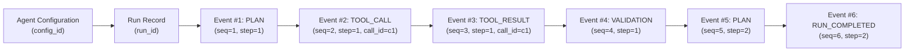
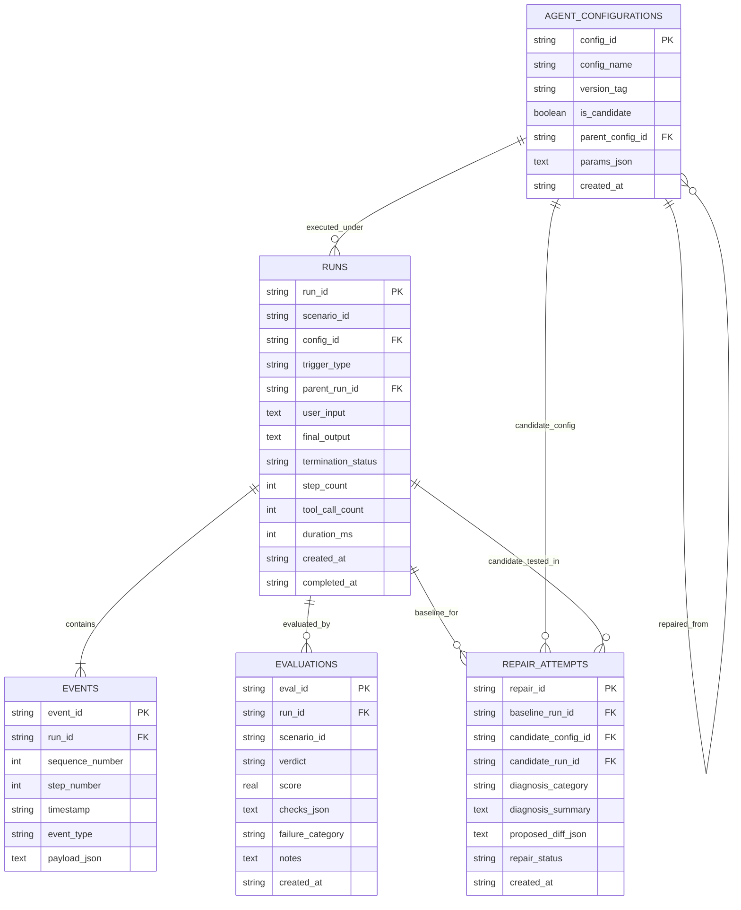

# Day 1 Design Document: Event Tracing & Local Database

**Project:** AI Agent Evaluation, Observability, and Safe Self-Repair Platform  
**Scope:** Event Tracing Schema, Observability Lifecycle, Local Storage, and Repair Candidate Lineage  
**Status:** Draft / Day 1 Proposal (No implementation code yet)  
**Companion Document:** [docs/day1_agent_and_tools.md](file:///Users/sahityasingh/.gemini/antigravity-ide/scratch/AI_project/docs/day1_agent_and_tools.md)

---

## 1. Executive Summary & Core Principles

This document defines the Day 1 architecture for **event tracing** and **local database persistence** for our simulated shop-support agent.

The primary goals are:
1. **Total Deterministic Observability:** Record every decision step, tool invocation, tool output, safety check, and lifecycle state transition across the six repeatable benchmark scenarios.
2. **Safe Self-Repair Lineage:** Keep baseline agent configurations strictly isolated from autofix repair candidates, providing full traceability from diagnosed failure to candidate test runs.
3. **Data Minimization & Privacy by Design:** Store exclusively synthetic, sanitized data. **Never** persist API keys, secrets, real customer personal identifiable information (PII), or unvetted internal chain-of-thought tokens.
4. **Lightweight Local-First Footprint:** Use an embedded, zero-dependency local storage engine suitable for Day 1 prototyping and automated local evaluation runs.

---

## 2. Information Required for a Run

Every evaluation or self-repair execution of the support agent produces a single top-level **Run** record. A run represents the end-to-end processing of a single synthetic customer query against the simulated shop environment.

### Run Entity Specification

| Field | Type | Required | Description / Purpose |
| :--- | :--- | :---: | :--- |
| `run_id` | String (UUIDv4) | Yes | Globally unique identifier for this specific execution. |
| `scenario_id` | String | Yes | Identifies which benchmark case was run (e.g., `scenario_1_ordinary_order`, `scenario_2_missing_order_id`, `scenario_5_tool_timeout`). |
| `config_id` | String (UUIDv4) | Yes | Foreign key to the exact agent configuration snapshot used for this run. |
| `trigger_type` | Enum | Yes | Origin of run: `BENCHMARK_EVAL` (baseline test suite), `REPAIR_TEST` (isolated test on a repair candidate), or `INTERACTIVE_DEBUG`. |
| `parent_run_id` | String (UUIDv4) | Optional | Populated if this run is testing a repair candidate created in response to an earlier failed run. |
| `user_input` | String | Yes | Synthetic customer prompt (e.g., `"Where is my order ORD-10024?"`). |
| `final_output` | String | Optional | The finalized customer-facing message produced by the agent (null if terminated prematurely by fatal error or limit). |
| `termination_status` | Enum | Yes | Terminal lifecycle status: `COMPLETED`, `STOPPED_STEP_LIMIT`, `STOPPED_TOOL_LIMIT`, `STOPPED_TIMEOUT`, `STOPPED_SAFETY_VIOLATION`, `STOPPED_ERROR`. |
| `step_count` | Integer | Yes | Total reasoning/action steps taken (capped by `max_steps`). |
| `tool_call_count` | Integer | Yes | Total tool calls executed (capped by `max_tool_calls`). |
| `duration_ms` | Integer | Yes | Total wall-clock execution duration in milliseconds. |
| `created_at` | String (ISO-8601 UTC) | Yes | Timestamp when the run was initiated. |
| `completed_at` | String (ISO-8601 UTC) | Optional | Timestamp when the run finalized or halted. |

> [!IMPORTANT]
> **Data Privacy & Minimization Policy:**
> - Stored inputs and outputs must only contain mock fixture data (e.g., order IDs in `ORD-XXXXX` format).
> - Raw environment variables, tokens, API credentials, and internal hidden model reasoning tokens are strictly excluded from run payloads.

---

## 3. Standardized Event Model

A run consists of an ordered stream of discrete **Events**. Each event captures a specific milestone, action, or guardrail check during the agent's execution.

### Common Event Envelope

Every event conforms to a consistent base schema:

```json
{
  "event_id": "evt_9b1deb4d-3b7d-4bad-9bdd-2b0d7b3dcb6d",
  "run_id": "run_a8098c1a-f86e-11da-bd1a-00112444be1e",
  "sequence_number": 3,
  "step_number": 2,
  "timestamp": "2026-11-02T18:00:01.120Z",
  "event_type": "TOOL_CALL",
  "payload": {}
}
```

### Event Types & Payload Schemas

The platform categorizes events into six standardized types:

#### 1. `PLAN`
Emitted at the beginning of an agent reasoning step. Summarizes the agent's high-level intent or plan without storing unconstrained hidden chain-of-thought tokens.
* **Payload Fields:**
  * `step_goal` (string): High-level description of what the agent intends to do (e.g., `"Inspect order status before retrieving line items"`).
  * `planned_tool` (string, optional): Tool name the agent intends to invoke next, or `"NONE"` if formulating a direct response.
  * `rationale_summary` (string): Sanitized public rationale explaining the chosen action.

#### 2. `TOOL_CALL`
Emitted immediately before invoking a mock tool.
* **Payload Fields:**
  * `call_id` (string, UUIDv4): Unique identifier correlating this invocation with its subsequent result.
  * `tool_name` (string): Name of the mock tool (`lookup_order_details`, `get_order_items`, `track_shipment`).
  * `input_arguments` (object): Key-value dictionary of sanitized inputs passed to the tool.
  * `attempt_number` (integer): 1-indexed attempt (e.g., `1` for initial call, `2` for retry).

#### 3. `TOOL_RESULT`
Emitted immediately after a mock tool completes its execution.
* **Payload Fields:**
  * `call_id` (string, UUIDv4): References the matching `TOOL_CALL.call_id`.
  * `tool_name` (string): Tool that produced the result.
  * `status` (string): `"SUCCESS"` or `"PARTIAL"`.
  * `latency_ms` (integer): Wall-clock duration of the tool execution in milliseconds.
  * `output_data` (object): Output payload returned by the mock service (e.g., order summary, tracking details).

#### 4. `ERROR`
Emitted whenever an exception, timeout, or handled fault occurs within the agent runtime or mock tool integration.
* **Payload Fields:**
  * `call_id` (string, optional): Associated `call_id` if the error occurred during a tool call.
  * `error_type` (string): Standardized error category (e.g., `TIMEOUT_ERROR`, `ORDER_NOT_FOUND`, `INVALID_INPUT`, `CARRIER_UNAVAILABLE`, `PAYLOAD_CORRUPT`, `LIMIT_EXCEEDED`).
  * `error_message` (string): Sanitized, human-readable description of the error (no raw stack traces).
  * `is_retryable` (boolean): Whether the agent runtime is permitted to retry under the current configuration.
  * `recovery_action` (string): Selected recovery path (e.g., `"RETRY_IMMEDIATE"`, `"FALLBACK_TO_USER"`, `"HALT"`).

#### 5. `VALIDATION`
Emitted by safety guardrails and schema validation layers before or after tool executions and final replies.
* **Payload Fields:**
  * `check_name` (string): Name of guardrail (e.g., `INPUT_ORDER_ID_PRESENT`, `TOOL_OUTPUT_SCHEMA_CHECK`, `CONFLICT_DETECTION_CHECK`, `READ_ONLY_GUARD`).
  * `validation_status` (string): `"PASSED"`, `"FAILED"`, or `"WARNING"`.
  * `details` (object): Contextual details (e.g., missing mandatory fields, detected data contradictions between `OrderService` and `ShippingService`).

#### 6. `RUN_STOPPED` / `RUN_COMPLETED`
The terminal event marking the conclusion of the agent execution.
* **Payload Fields:**
  * `reason` (string): Terminal reason (e.g., `GOAL_ACHIEVED`, `MAX_STEPS_REACHED`, `MAX_TOOL_CALLS_REACHED`, `TOTAL_TIMEOUT_REACHED`, `FATAL_ERROR`).
  * `exit_code` (integer): `0` for normal completion, non-zero for error/limit stops.
  * `final_response_preview` (string): Short snippet of the response delivered to the customer.

---

## 4. Event Ordering & Linkage

To ensure absolute causal order and reliable traceability:



1. **Intra-Run Ordering (Sequence Numbers):**
   * Every event within a run is assigned a strictly increasing integer: `sequence_number = 1, 2, 3, ...`.
   * Queries order by `(run_id, sequence_number ASC)` to guarantee exact chronological replay regardless of clock skew or millisecond timestamp collisions.
2. **Step Association:**
   * Events include `step_number` (1 to `max_steps`), grouping all sub-actions belonging to a single reasoning turn.
3. **Tool Call Correlation:**
   * `TOOL_CALL` and `TOOL_RESULT` pairs share an identical `call_id`.
   * If a tool call times out or throws an error, the corresponding `ERROR` event also references that `call_id`.
4. **Configuration Linkage:**
   * Every `Run` contains `config_id`, directly referencing the immutable configuration record in the `agent_configurations` table.
   * Runs cannot be orphaned: foreign key constraints ensure events point to valid runs, and runs point to valid configurations.

---

## 5. Sample Trace in JSON

The following minimal, synthetic trace illustrates a complete two-step run where the agent handles Scenario 1 (Ordinary Order), plans a tool call, executes `lookup_order_details`, verifies the result, and completes the run.

```json
{
  "run": {
    "run_id": "run_9f2c31e2-45a7-4e6b-a274-1296ec5188f1",
    "scenario_id": "scenario_1_ordinary_order",
    "config_id": "cfg_base_20261102_v1",
    "trigger_type": "BENCHMARK_EVAL",
    "parent_run_id": null,
    "user_input": "Hello, could you check the status of my order ORD-10024?",
    "final_output": "Your order ORD-10024 is currently PROCESSING. The total amount is $128.50. It was placed on 2026-11-01T14:30:00Z.",
    "termination_status": "COMPLETED",
    "step_count": 2,
    "tool_call_count": 1,
    "duration_ms": 48,
    "created_at": "2026-11-02T18:00:00.000Z",
    "completed_at": "2026-11-02T18:00:00.048Z"
  },
  "events": [
    {
      "event_id": "evt_001",
      "run_id": "run_9f2c31e2-45a7-4e6b-a274-1296ec5188f1",
      "sequence_number": 1,
      "step_number": 1,
      "timestamp": "2026-11-02T18:00:00.005Z",
      "event_type": "PLAN",
      "payload": {
        "step_goal": "Validate extracted order ID format and look up primary order details.",
        "planned_tool": "lookup_order_details",
        "rationale_summary": "Extracted valid ID ORD-10024 from user query. Querying mock order service."
      }
    },
    {
      "event_id": "evt_002",
      "run_id": "run_9f2c31e2-45a7-4e6b-a274-1296ec5188f1",
      "sequence_number": 2,
      "step_number": 1,
      "timestamp": "2026-11-02T18:00:00.010Z",
      "event_type": "TOOL_CALL",
      "payload": {
        "call_id": "call_c821ea3a-1011",
        "tool_name": "lookup_order_details",
        "input_arguments": {
          "order_id": "ORD-10024"
        },
        "attempt_number": 1
      }
    },
    {
      "event_id": "evt_003",
      "run_id": "run_9f2c31e2-45a7-4e6b-a274-1296ec5188f1",
      "sequence_number": 3,
      "step_number": 1,
      "timestamp": "2026-11-02T18:00:00.025Z",
      "event_type": "TOOL_RESULT",
      "payload": {
        "call_id": "call_c821ea3a-1011",
        "tool_name": "lookup_order_details",
        "status": "SUCCESS",
        "latency_ms": 15,
        "output_data": {
          "order_id": "ORD-10024",
          "status": "PROCESSING",
          "customer_id": "CUST-883",
          "created_at": "2026-11-01T14:30:00Z",
          "total_amount": 128.50,
          "currency": "USD"
        }
      }
    },
    {
      "event_id": "evt_004",
      "run_id": "run_9f2c31e2-45a7-4e6b-a274-1296ec5188f1",
      "sequence_number": 4,
      "step_number": 1,
      "timestamp": "2026-11-02T18:00:00.028Z",
      "event_type": "VALIDATION",
      "payload": {
        "check_name": "TOOL_OUTPUT_SCHEMA_CHECK",
        "validation_status": "PASSED",
        "details": {
          "required_fields": ["order_id", "status", "total_amount"],
          "missing_fields": []
        }
      }
    },
    {
      "event_id": "evt_005",
      "run_id": "run_9f2c31e2-45a7-4e6b-a274-1296ec5188f1",
      "sequence_number": 5,
      "step_number": 2,
      "timestamp": "2026-11-02T18:00:00.035Z",
      "event_type": "PLAN",
      "payload": {
        "step_goal": "Synthesize verified order information into customer response.",
        "planned_tool": "NONE",
        "rationale_summary": "All required order details retrieved successfully without error."
      }
    },
    {
      "event_id": "evt_006",
      "run_id": "run_9f2c31e2-45a7-4e6b-a274-1296ec5188f1",
      "sequence_number": 6,
      "step_number": 2,
      "timestamp": "2026-11-02T18:00:00.048Z",
      "event_type": "RUN_COMPLETED",
      "payload": {
        "reason": "GOAL_ACHIEVED",
        "exit_code": 0,
        "final_response_preview": "Your order ORD-10024 is currently PROCESSING..."
      }
    }
  ]
}
```

---

## 6. Local Database Structure (Proposed Schema)

For Day 1, we propose an embedded **SQLite database** stored at `data/agentops_local.db`.

### Why SQLite for Day 1?
- **Zero Configuration:** No external database process, network setup, or credentials needed.
- **Portability:** The entire test database is a single local file easily reset, copied, or inspected in CI/CD and developer machines.
- **Structured JSON Support:** Built-in JSON operations (`json_extract`, `json_object`) allow flexible payload inspection without sacrificing relational indexing.
- **ACID Transactions:** Clean isolation when recording concurrent or sequential evaluation runs.

### Entity Relationship Diagram



### Table Definitions

#### Table 1: `agent_configurations`
Stores versioned, immutable snapshots of agent configurations.

| Column | Type | Constraints | Description |
| :--- | :--- | :--- | :--- |
| `config_id` | TEXT | PRIMARY KEY | Unique ID (e.g., `cfg_base_v1`, `cfg_candidate_timeout_fix_01`). |
| `config_name` | TEXT | NOT NULL | Human-friendly name (e.g., `"Baseline Configuration"`). |
| `version_tag` | TEXT | NOT NULL | SemVer or label (e.g., `"1.0.0"`, `"1.0.1-candidate"`). |
| `is_candidate` | INTEGER | NOT NULL DEFAULT 0 | `0` = Active/Baseline config; `1` = Autofix repair candidate. |
| `parent_config_id`| TEXT | REFERENCES `agent_configurations(config_id)` | Link to ancestor configuration from which this was branched. |
| `params_json` | TEXT | NOT NULL | Serialized JSON containing all execution bounds and prompts (`tool_timeout_seconds`, `max_retries_per_tool`, etc.). |
| `created_at` | TEXT | NOT NULL | ISO-8601 UTC timestamp. |

#### Table 2: `runs`
Captures each individual execution of the agent.

| Column | Type | Constraints | Description |
| :--- | :--- | :--- | :--- |
| `run_id` | TEXT | PRIMARY KEY | Unique run UUID. |
| `scenario_id` | TEXT | NOT NULL | Evaluated scenario identifier (`scenario_1` to `scenario_6`). |
| `config_id` | TEXT | NOT NULL REFERENCES `agent_configurations(config_id)` | Associated configuration snapshot. |
| `trigger_type` | TEXT | NOT NULL | `"BENCHMARK_EVAL"`, `"REPAIR_TEST"`, `"MANUAL"`. |
| `parent_run_id` | TEXT | REFERENCES `runs(run_id)` | Associated baseline run if this is a candidate verification run. |
| `user_input` | TEXT | NOT NULL | Synthetic customer query. |
| `final_output` | TEXT | NULL | Customer response text. |
| `termination_status`| TEXT | NOT NULL | `"COMPLETED"`, `"STOPPED_LIMIT"`, etc. |
| `step_count` | INTEGER | NOT NULL | Total steps executed. |
| `tool_call_count` | INTEGER | NOT NULL | Total tool calls executed. |
| `duration_ms` | INTEGER | NOT NULL | Wall-clock execution time in ms. |
| `created_at` | TEXT | NOT NULL | ISO-8601 start timestamp. |
| `completed_at` | TEXT | NULL | ISO-8601 end timestamp. |

#### Table 3: `events`
Stores the high-resolution event stream for each run.

| Column | Type | Constraints | Description |
| :--- | :--- | :--- | :--- |
| `event_id` | TEXT | PRIMARY KEY | Unique event UUID. |
| `run_id` | TEXT | NOT NULL REFERENCES `runs(run_id)` | Enclosing run. |
| `sequence_number`| INTEGER | NOT NULL | Monotonic sequence number (1, 2, ...). |
| `step_number` | INTEGER | NOT NULL | Reasoning step turn index. |
| `timestamp` | TEXT | NOT NULL | ISO-8601 UTC timestamp. |
| `event_type` | TEXT | NOT NULL | `"PLAN"`, `"TOOL_CALL"`, `"TOOL_RESULT"`, `"ERROR"`, `"VALIDATION"`, `"RUN_STOPPED"`. |
| `payload_json` | TEXT | NOT NULL | Serialized JSON specific to the event type. |

*Indexes:*
* `CREATE UNIQUE INDEX idx_events_run_seq ON events(run_id, sequence_number);`
* `CREATE INDEX idx_events_type ON events(event_type);`

#### Table 4: `evaluations`
Stores automated test judge assertions and rubric results for a completed run.

| Column | Type | Constraints | Description |
| :--- | :--- | :--- | :--- |
| `eval_id` | TEXT | PRIMARY KEY | Unique evaluation UUID. |
| `run_id` | TEXT | NOT NULL REFERENCES `runs(run_id)` | Evaluated run. |
| `scenario_id` | TEXT | NOT NULL | Benchmark scenario ID. |
| `verdict` | TEXT | NOT NULL | Overall assessment: `"PASS"` or `"FAIL"`. |
| `score` | REAL | NOT NULL | Continuous metric (0.0 to 1.0). |
| `checks_json` | TEXT | NOT NULL | Detailed boolean breakdown of checks (e.g., `{"order_id_prompted": true, "no_hallucinations": true}`). |
| `failure_category`| TEXT | NULL | Diagnosed category if failed (e.g., `"TIMEOUT"`, `"SCHEMA_VIOLATION"`, `"UNHANDLED_CONFLICT"`). |
| `notes` | TEXT | NULL | Evaluator comments or diagnostics. |
| `created_at` | TEXT | NOT NULL | ISO-8601 UTC timestamp. |

#### Table 5: `repair_attempts`
Tracks diagnosed failures, proposed autofixes, and candidate verification runs.

| Column | Type | Constraints | Description |
| :--- | :--- | :--- | :--- |
| `repair_id` | TEXT | PRIMARY KEY | Unique repair attempt UUID. |
| `baseline_run_id` | TEXT | NOT NULL REFERENCES `runs(run_id)` | Failed run that triggered the repair workflow. |
| `candidate_config_id` | TEXT | NOT NULL REFERENCES `agent_configurations(config_id)` | Modified configuration candidate created to fix the issue. |
| `candidate_run_id` | TEXT | REFERENCES `runs(run_id)` | Isolated test run executing the candidate config. |
| `diagnosis_category` | TEXT | NOT NULL | Classification from diagnostic engine. |
| `diagnosis_summary` | TEXT | NOT NULL | Root-cause summary. |
| `proposed_diff_json` | TEXT | NOT NULL | Structured delta between baseline and candidate config parameters. |
| `repair_status` | TEXT | NOT NULL | Lifecycle: `"PROPOSED"`, `"TESTED_PASSED"`, `"TESTED_FAILED"`, `"ACCEPTED_ACTIVE"`, `"REJECTED"`. |
| `created_at` | TEXT | NOT NULL | ISO-8601 UTC timestamp. |

---

## 7. Distinguishing Original Configurations vs. Repair Candidates

To ensure safe self-repair without risking production instability or accidental regressions, the platform enforces strict structural separation between **Original (Baseline)** configurations and **Repair Candidates**:

### 1. Immutability & Branching Principle
- **No in-place updates:** Existing configurations are strictly immutable. Once inserted into `agent_configurations`, records are never updated or overwritten.
- **Explicit Branching:** A repair candidate is always inserted as a *new* configuration row with `is_candidate = 1` and a `parent_config_id` pointing directly to the baseline configuration it was branched from.

### 2. Transparent Structural Parameter Diff
Every repair attempt stores an explicit JSON delta in `proposed_diff_json`, clearly highlighting modified values:

```json
{
  "modified_parameters": {
    "tool_timeout_seconds": {
      "original": 2.0,
      "candidate": 3.5,
      "rationale": "Compensate for simulated carrier API jitter observed in Scenario 5."
    },
    "max_retries_per_tool": {
      "original": 1,
      "candidate": 2,
      "rationale": "Permit single retry on transient timeouts."
    }
  }
}
```

### 3. Isolated Run Tagging (`trigger_type = 'REPAIR_TEST'`)
- When a candidate configuration is evaluated, its run record sets:
  * `trigger_type = 'REPAIR_TEST'`
  * `parent_run_id = <original_failed_run_id>`
  * `config_id = <candidate_config_id>`
- This guarantees that automated analytics distinguish baseline benchmark metrics from experimental autofix tests.

### 4. Promotion Gate (Human or Multi-Scenario Verification)
A repair candidate can **never** silently overwrite the baseline:
* The candidate must first pass the failing scenario on its isolated copy run (`candidate_run_id`).
* The candidate must pass the **regression test suite** (all remaining 5 benchmark scenarios) without degrading performance.
* An explicit promotion action is required to update `repair_status = 'ACCEPTED_ACTIVE'`, creating a new official baseline version tag.

---

## 8. Alignment with Teammate Modules

To ensure seamless integration with the Agent & Tools specification in [docs/day1_agent_and_tools.md](file:///Users/sahityasingh/.gemini/antigravity-ide/scratch/AI_project/docs/day1_agent_and_tools.md):

1. **Mock Tools Alignment:**
   * The `TOOL_CALL` and `TOOL_RESULT` event schemas directly mirror the inputs, outputs, and simulated errors of `lookup_order_details`, `get_order_items`, and `track_shipment`.
2. **Execution Limits Guardrails:**
   * The database records enforce and verify the limits defined in Section 5 of the companion document (`max_steps = 4`, `max_tool_calls = 3`, `tool_timeout = 2.0s`, `total_session_timeout = 10.0s`).
3. **Autofix Parameter Set:**
   * The `params_json` and `proposed_diff_json` schemas directly support the five configurable settings listed for safe autofix (`retry_count`, `tool_timeout_seconds`, `clarification_prompt_template`, `conflict_resolution_strategy`, `schema_fallback_rules`).

---

## 9. Open Questions & Team Decisions

Before proceeding to Day 2 implementation, the whole team should confirm the following architectural decisions:

1. **Storage Mechanics for Day 1 Development:**
   * *Option A (Recommended):* Single local SQLite file `data/agentops_local.db` with an automated schema initialization script.
   * *Option B:* Dual storage (SQLite for structured queries + individual JSON files in `data/traces/<run_id>.json` for rapid visual inspection in text editors).
   * *Decision needed:* Does the team prefer querying SQLite directly, or should the runner also dump raw JSON trace files per run?

2. **Evaluation Execution Lifecycle:**
   * Should evaluation assertions run **synchronously** immediately after a run completes (saving both run and evaluation in one transaction), or **asynchronously** via a separate evaluator script?
   * *Recommendation:* Synchronous inline evaluation for Day 1 to keep test scripts single-pass and deterministic.

3. **Chain-of-Thought Filtering Boundary:**
   * How should the agent runtime separate private reasoning from public planning?
   * *Recommendation:* Only emit high-level structured intent in the `PLAN` event (`step_goal` and `planned_tool`), strictly omitting raw LLM scratchpads or hidden reasoning tokens.

4. **Autofix Candidate Promotion Threshold:**
   * When a repair candidate passes the test case it was designed to fix, does it require an automated 6/6 scenario pass rate across the full benchmark before marking `TESTED_PASSED`?
   * *Recommendation:* Yes. A candidate must never introduce regressions into the other 5 scenarios.

5. **Local Database Reset Policy:**
   * Should local test runs auto-migrate or reset between test suite invocations?
   * *Recommendation:* Provide a `--reset-db` CLI flag in the runner script to allow fresh starts while preserving historical traces by default.
